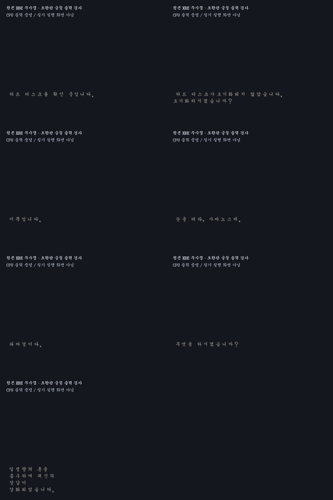
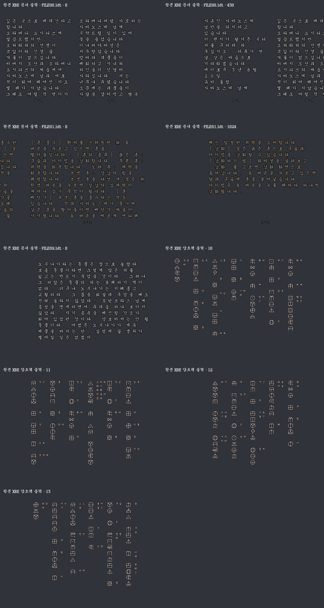
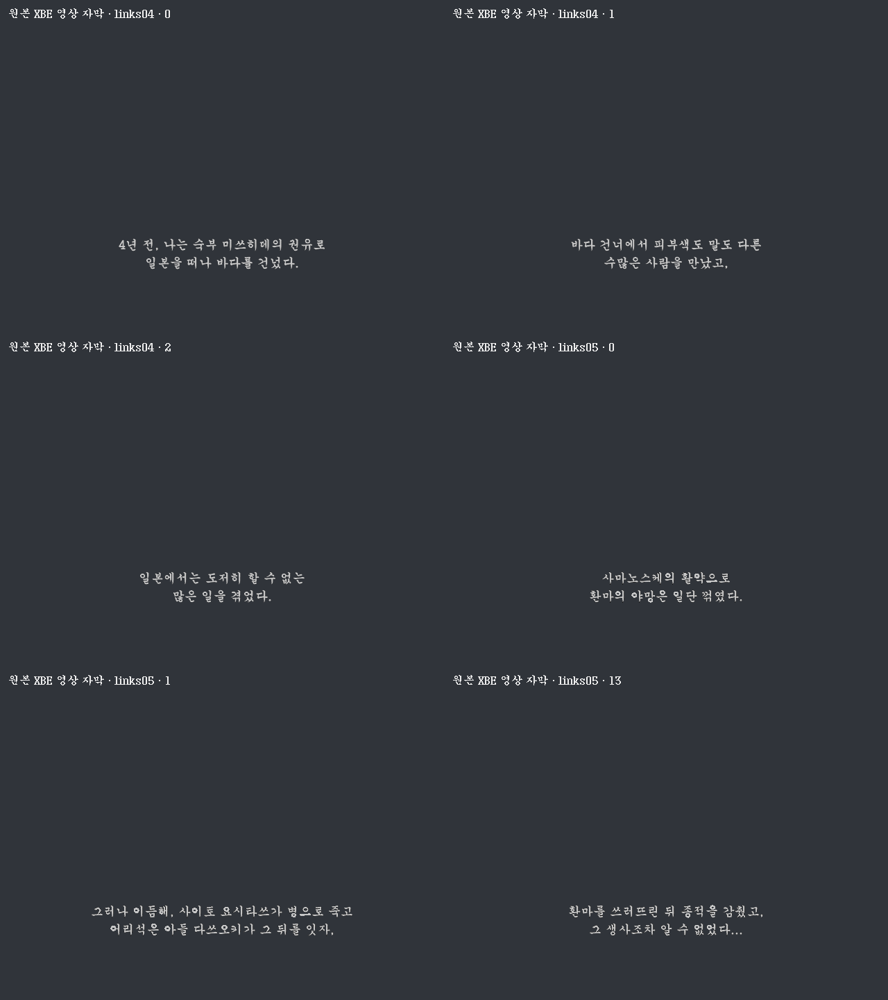

# XBOX-Genma-Onimusha-Kr · v0.802 원본 XBE 호환판

Xbox용 **환마 귀무자 (Genma Onimusha)** 일본판 한국어 데이터 패치입니다.

**한글화: 기타 깎는 노인**

맨 위 타이틀 이미지는 기존 개발 캡처입니다. v0.802 실기 실행 캡처는 아닙니다.

**일본판 원본 ISO → 원본 XBE를 그대로 포함한 한글 ISO 한 파일**을 생성합니다. `default.xbe`의 실행 코드·문자열·헤더·서명·매체 설정을 수정하지 않습니다. 별도 로더나 실행 중 코드 패치도 사용하지 않습니다.

## 다운로드와 적용

1. [v0.802 릴리스](https://github.com/OldManCraveGuitars-bit/XBOX-Genma-Onimusha-Kr/releases/tag/v0.802)에서 **`XBOX-Genma-Onimusha-Kr-v0.802-Windows-Patcher.zip`**을 내려받고 압축을 풉니다.
2. `XBOX-Genma-Onimusha-Kr-v0.802-Patcher.exe`를 실행합니다. 단독 EXE도 같은 기능입니다.
3. **`Genma Onimusha (Japan) (En,Ja)` 일본판 원본 ISO**를 선택합니다.
4. 새 ISO 저장 위치를 지정하고 **한글 패치 시작**을 누릅니다.
5. 결과 ISO와 내부 원본 XBE의 해시 검사가 끝날 때까지 기다립니다.
6. 게임의 **문자 언어를 `日本語`(일본어)**로 두세요. 음성 설정은 별개입니다.

v0.8/v0.801 선행 적용이나 XBE 수동 교체는 필요 없습니다. 기존 한글판 사용자도 일본판 원본에서 새로 생성하세요.

Windows 10/11 64비트용이며 Python 설치가 필요 없습니다. 출력 위치에 **6GB 이상**, 임시 폴더에 **200MB 이상**의 빈 공간이 필요합니다. 원본과 기존 출력 파일은 덮어쓰지 않습니다. 결과 ISO는 4GB를 넘으므로 NTFS 또는 exFAT에 저장하세요.

## 호환판의 한글화 범위

- 대사·조사문·시스템 메시지 **3,272행**, 본문 **3,768페이지**를 원본 글자 출력 경로에 맞춰 재구성했습니다.
- 타이틀·조작·설정·랭크 등 이미지에 들어간 한글은 데이터로 유지합니다.
- 일반 문서와 지침서는 원래 읽기 화면과 스크롤 범위 안에서 **가로쓰기**를 사용합니다. 여러 쪽 문서는 쪽 번호를 표시하며, 이동 방향은 일본판의 원래 스크롤 방식을 따릅니다.
- 암호책은 가상 문자와 원래 해금 영역을 유지하고, 각 영역 안에 한글 풀이를 넣습니다.
- 원래 자막 표시 경로가 있는 영상 **2편(회상·엔딩)**은 원래 시간표와 이미지 칸을 사용해 한글화합니다.

**XBE 안에 고정된 아이템 이름·메뉴 문구·아이템 설명·선택지 327항목은 일본어 원문을 유지합니다.** 이전 수정 XBE에서 추가했던 오프닝 음성 자막·기타 영상 자막·한글 스크롤 크레딧은 포함하지 않습니다. 오프닝 편지 원화는 일본어 그대로 유지합니다.

영문 문자 모드는 이 데이터 배치의 지원 대상이 아닙니다. 문자 언어를 일본어로 선택하세요. 글꼴은 궁서 계열로 생성했습니다.

## 원본 보존과 검증

| 대상 | 크기 (bytes) | SHA-256 |
| --- | ---: | --- |
| 일본판 원본 ISO | 4,905,566,208 | `7f5af784f9b229c5d0061918e018a9052e328a5341efc7d9e1b5d36de5f58206` |
| v0.802 호환판 결과 ISO | 5,370,583,040 | `57af5fbffc41aa59656841b07492027570211e1ddeeacb27b865631ae4d50688` |
| ISO 내부 원본 default.xbe | 2,367,488 | `149f8392db82bbe092ce9b042310373e4645fa898624f57eea55a0c145885216` |

- XBE는 원본과 **바이트 단위로 동일**하며, ISO의 원래 위치와 디렉터리 기록도 그대로입니다. 원본 23개 섹션과 인증서·서명·실행 코드가 보존됩니다.
- 전체 ISO의 **1,820개 항목**을 다시 읽고 원본과 모든 바이트를 비교했습니다. 허용한 데이터 변경 영역 밖의 변경은 **0바이트**입니다.
- 원본 CPU 코드로 글꼴 변환·스위즐 **107종**을 검사했습니다. 원본 리소스 밖 읽기와 검사 영역 밖 쓰기가 없었습니다. GPU 드라이버 할당·잠금은 경계에서 대체한 검사입니다.
- 원본 로더로 텍스트 리소스 **239개**를 처리하고, 모든 스크립트 복사가 원본 메모리 사용량 이내인지 확인했습니다.
- 본문 **3,768페이지**, 선택지 **28조건**, 일반 문서·지침서 **18종**, 암호 해금 **64조건**, 원래 영상 자막 **15,376프레임**을 검사했습니다.
- 배포할 Windows EXE에 일본판 ISO를 실제로 적용하여 전체 결과 ISO를 생성했습니다. 결과 SHA-256과 내부 XBE의 원본 일치를 독립적으로 다시 확인했습니다.

**실기 Xbox 부팅과 전체 플레이는 미검증입니다.** 기존 실행 불가 제보의 원인을 확정하거나 실기 해결을 확정한 배포물로 표시하지 않습니다.

[MD5·SHA-1·SHA-256 목록](HASHES-v0.802.md) · [배포 파일 SHA-256](SHA256SUMS.txt) · [원본 XBE 데이터 검사](docs/verification/stock-xbe-v0.802.json) · [배포 EXE 실제 적용 검사](docs/verification/patcher-v0.802.json)

## 데이터 출력 검사 이미지

아래는 원본 x86 코드가 만든 좌표로 그린 CPU 검사 이미지입니다. 에뮬레이터나 실기 실행 캡처가 아닙니다.







## 패처 소스 재빌드

배포 `.xdelta`를 `patches/`에 두고, LZMA를 지원하는 [Xdelta 3.2.1](https://github.com/jmacd/xdelta/releases/tag/v3.2.1)의 전체 Windows x86-64 `xdelta3.exe`를 준비합니다. 패키징은 Python 3.11 이상과 Windows .NET Framework C# 컴파일러를 사용합니다. `release-config.json`의 원본·결과·XBE 해시를 확인합니다.

```powershell
python tools/package_release.py --source "일본판 원본.iso" --target "v0.802 호환판.iso" --decoder "xdelta3.exe"
python tools/verify_release.py --source "일본판 원본.iso" --patched-input "v0.802 호환판.iso" --output "검증용 새 ISO.iso"
```

게임 원본 자료와 완성 ISO는 저장소·배포물에 포함하지 않습니다. 출력은 XDVDFS 게임 이미지이며, 설치용 추출·변환은 사용하는 로더의 형식에 맞게 진행하세요. 외부 구성 요소의 출처와 라이선스는 [licenses](licenses/THIRD-PARTY.md)에 있습니다.
