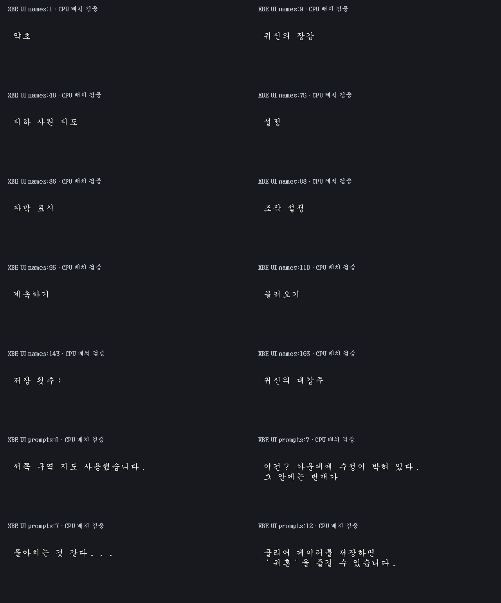
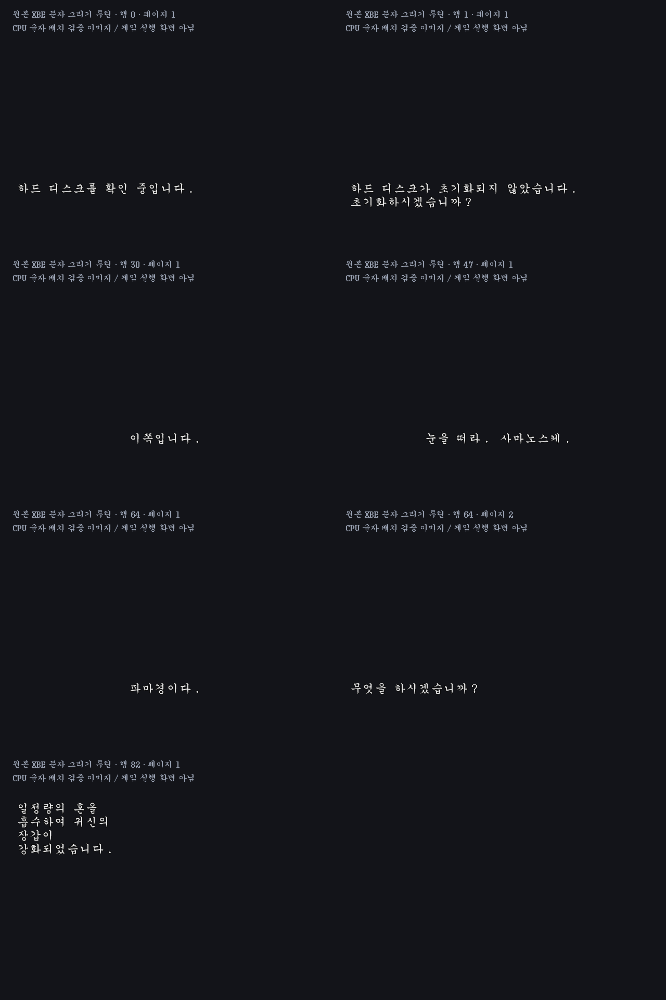

# XBOX-Genma-Onimusha-Kr · v0.804

Xbox용 **환마 귀무자 (Genma Onimusha)** 일본판 한국어 패치입니다.

**한글화: 기타 깎는 노인**

**일본판 원본 ISO → 전체 한글화를 포함한 ISO 한 파일**을 만듭니다. 수정 `default.xbe`와 번역 데이터가 ISO 안에 들어 있습니다. 이번 한글화를 위한 별도 실행 로더·RAM 패처·플러그인·외부 설정 파일은 필요 없습니다.

맨 위 이미지는 **최종 v0.804 파일의 PC Cxbx Retail 모드 실제 타이틀 캡처**입니다. **Xbox 360/XeFu 및 실기 Xbox 실행은 미검증**이며, 기존 실행 불가 제보가 해결되었다고 확정한 버전은 아닙니다.

## 다운로드와 적용

1. [v0.804 릴리스](https://github.com/OldManCraveGuitars-bit/XBOX-Genma-Onimusha-Kr/releases/tag/v0.804)에서 **`XBOX-Genma-Onimusha-Kr-v0.804-Windows-Patcher.zip`**을 받고 압축을 풉니다.
2. `XBOX-Genma-Onimusha-Kr-v0.804-Patcher.exe`를 실행합니다. 단독 EXE도 같은 기능입니다.
3. **`Genma Onimusha (Japan) (En,Ja)` 일본판 원본 ISO**를 선택합니다.
4. 새 ISO 저장 위치를 정하고 **한글 패치 시작**을 누릅니다.
5. 결과 ISO와 내부 XBE의 해시 검증 및 완료 메시지를 기다립니다.
6. 게임의 **문자 언어를 `日本語`(일본어)**로 두세요. 음성 설정은 별개입니다.

이전 버전 선행 적용이나 XBE 수동 교체는 필요 없습니다. 기존 한글판 사용자도 일본판 원본에서 새로 생성하세요. 다른 지역판·수정된 ISO·폴더 덤프는 입력으로 지원하지 않습니다.

Windows 10/11 64비트용이며 Python 설치는 필요 없습니다. 출력 위치에 **6GB 이상**, 임시 폴더에 **200MB 이상**의 여유 공간이 필요합니다. 원본과 기존 출력 파일은 덮어쓰지 않습니다. 4GB가 넘는 결과 ISO는 **NTFS 또는 exFAT**에 저장하세요.

단일 ISO는 패치 결과물 형식입니다. Xbox/360에서 원래 사용하던 게임 실행 환경과 설치 절차는 필요합니다. 결과는 XDVDFS 이미지이며, 사용 환경에 따라 일반적인 추출·변환을 진행해야 합니다. 5GB ISO 자체를 FATX에 한 파일로 복사할 수 있다는 뜻은 아닙니다.

## 한글화와 변경 내용

- 대사·조사문·시스템 메시지, 본문 **3,768페이지**, 일반 문서와 지침서, 암호책 풀이를 포함합니다. 암호의 기호·문서 해금·풀이 순서는 유지합니다.
- v0.802에서 일본어로 남겼던 **메뉴·아이템명·설명·선택지 327행**의 한글 처리를 포함합니다.
- 오프닝을 포함한 영상의 **시간 지정 자막 86개**와 한글 크레딧을 포함합니다. 전체 영상을 끝까지 실행 검증한 것은 아닙니다.
- 인게임 자막 가운데 정렬, 아이템 획득 문구 두 줄 배치, 선택지 간격, 문서의 종이 영역, 지도 제목 가운데 정렬을 반영합니다.
- 타이틀의 시작 버튼 안내를 아래로 이동하고, 랭크·조작·저장 화면·암호책 버튼과 탭 이미지를 보수한 전체 한글 리소스를 포함합니다.
- 동일한 자막 이미지 20건을 공유해 **추가 선행 로드 메모리를 143,360바이트 줄였습니다.** 기존 전체 한글판의 글자와 화면 좌표는 유지합니다.

v0.803은 로컬 비교 후보였으며 공개 릴리스가 아닙니다. v0.804는 v0.802의 원본 XBE 부분 한글화 방식에서 전체 한글화 방식으로 돌아온 버전입니다. XBE 무수정판으로 표시하지 않습니다.

## 일본판과 유지·변경한 부분

| 항목 | v0.804 |
| --- | --- |
| 기존 23개 섹션 주소·길이·플래그·섹션 표 시작 위치 | 일본판과 동일 |
| 진입점·커널 참조 116개·TLS·시작 스택/힙 설정 | 일본판과 동일 |
| 인증서 전체·타이틀 ID·키·지역 `0x2`·허용 매체 `0x2` | 일본판과 동일 |
| 기존 실행 코드와 데이터 | `.text` 206바이트, `.data` 1,225바이트 변경 |
| 그 외 원본 21개 섹션 내용 | 일본판과 동일 |
| 추가 섹션 | 한글 코드·데이터용 `KRDATA` 1개, 총 24개 섹션 |
| ISO 파일·디렉터리 이름 1,820항목 | 일본판과 동일 |
| ISO 내 파일 위치 | 검수된 전체 한글 r16 배치 유지; 일본판의 모든 LBA와 같지는 않음 |

추가 섹션에 필요한 헤더·이미지 크기·해시도 바뀝니다. **XBE 전체가 원본과 동일한 것은 아닙니다.** 수정된 헤더는 원본 정품 서명과 일치하지 않으므로, 사용하는 실행 환경이 수정 XBE를 허용해야 합니다. 일본판 형태에 가까운 구성이라는 사실만으로 360 실행을 보장하지 않습니다.

## 검사 결과

- 검사 모듈 **12개** 통과, 실제 x86 코드의 글자 배치 **5,219건**이 기존 전체 한글판과 일치했습니다.
- 본문 **3,768페이지**, UI 327행, 저장 장치 설명·문서 범위·지도 제목·수량 간격·암호책 해금 상태를 검사했습니다.
- 읽기·실행 전용 추가 공간에서 **7,917회**, 원본 텍스처 변환·스위즐 8건, 컨테이너 복사 239건을 검사했습니다.
- CPU 출력 검사 이미지 **9장**과 실제 GPU 타이틀 화면이 이전 전체 한글판과 픽셀 단위로 같았습니다.
- 최종 XBE와 게임 파일 **1,743개**로 PC Cxbx Retail 모드의 초기화·영상 프레임 진행·타이틀 진입을 확인했습니다. 별도 한글 RAM 주입이나 QA 입력 후크를 사용하지 않았습니다.
- ISO 전체를 검수된 전체 한글 r16과 비교했습니다. XBE 할당 영역·해당 길이 필드 외 예상 밖 변경은 **0바이트**이고, 줄어든 XBE 뒤 143,360바이트는 0으로 정리했습니다.
- 배포 Windows EXE로 일본판 원본에서 ISO를 실제 생성하여 결과 해시·파일 목록·내부 XBE·원본 인증서 보존을 다시 확인했습니다. 잘못된 입력 거부, 기존 파일 보존, 생성 중 취소·미완성 파일 정리도 검사했습니다.

**미검증:** Xbox 360/XeFu 부팅, 실기 Xbox 부팅, 전체 플레이, 모든 영상의 끝까지 재생, 64MB 환경의 전체 구간 최대 메모리 사용량. 이번 릴리스는 이 한계를 표시한 사전 배포판입니다.

[패처 실제 적용 검사](docs/verification/patcher-v0.804.json) · [취소·화면 검사](docs/verification/patcher-extra-v0.804.json) · [ISO 검사](docs/verification/v0.804/iso.json) · [품질 검사](docs/verification/v0.804/quality.json) · [일본판 구조 비교](docs/verification/v0.804/retail_parity.json) · [PC 실행 검사](docs/verification/v0.804/boot.json)

## 해시

| 대상 | 크기 (bytes) | SHA-256 |
| --- | ---: | --- |
| 일본판 원본 ISO | 4,905,566,208 | `7f5af784f9b229c5d0061918e018a9052e328a5341efc7d9e1b5d36de5f58206` |
| v0.804 결과 ISO | 5,385,351,168 | `d1c5d44274ceef631e020ef8c2e04c1b855b64d27ea30717d3e142653ca7b877` |
| ISO 내부 수정 default.xbe | 3,325,952 | `7378d7fb559468c19250ac692d18e3a2b312447ef3f66eb58018b7f14ce9edfa` |

[MD5·SHA-1·SHA-256 목록](HASHES-v0.804.md) · [배포 파일 SHA-256](SHA256SUMS.txt)

## 한글 배치 검사 이미지

아래는 **원본 x86 글자 배치 코드의 결과로 그린 CPU 검사 이미지**입니다. 에뮬레이터나 실기 실행 스크린샷이 아닙니다.





## 패처 소스 재빌드

릴리스의 `.xdelta`를 `patches/`에 두고, LZMA를 지원하는 [Xdelta 3.2.1](https://github.com/jmacd/xdelta/releases/tag/v3.2.1) Windows x86-64 `xdelta3.exe`를 준비하세요. 패키징은 Python 3.11 이상과 Windows .NET Framework C# 컴파일러를 사용합니다. `release-config.json`에 원본·결과·XBE 해시를 고정했습니다.

```powershell
python tools/package_single_iso_release.py --source "일본판 원본.iso" --target "v0.804 결과.iso" --decoder "xdelta3.exe"
python tools/verify_release.py --source "일본판 원본.iso" --patched-input "v0.804 결과.iso" --output "검증용 새 ISO.iso"
```

이 저장소는 배포 패처 소스·해시·검사 자료를 제공합니다. 게임 원본·완성 ISO·전체 게임 파일은 포함하지 않습니다. 외부 구성 요소의 출처와 라이선스는 [licenses](licenses/THIRD-PARTY.md)에 있습니다. 이전 릴리스와 검사 자료는 [릴리스 목록](https://github.com/OldManCraveGuitars-bit/XBOX-Genma-Onimusha-Kr/releases)과 버전별 문서에 보존합니다.
