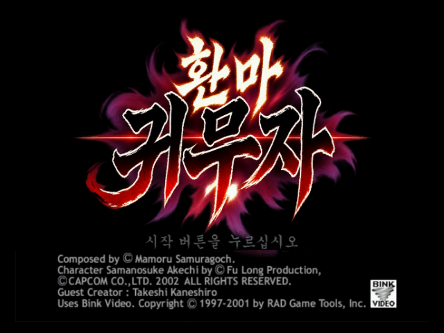
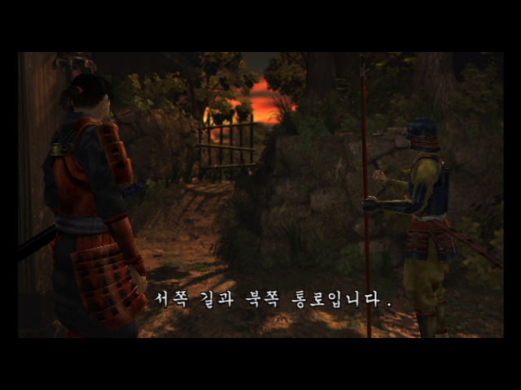
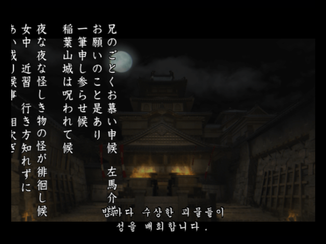

# XBOX-Genma-Onimusha-Kr · v0.801

Xbox용 **환마 귀무자 (Genma Onimusha)** 일본판 한국어 패치입니다.

**한글화: 기타 깎는 노인**

## v0.801 테스트 업데이트

**기존 v0.8 한글 게임 폴더의 `default.xbe`를 교체하는 업데이트입니다.**

[v0.801 다운로드](https://github.com/OldManCraveGuitars-bit/XBOX-Genma-Onimusha-Kr/releases/tag/v0.801) · [적용 방법](docs/releases/v0.801.md) · [파일 해시](HASHES-v0.801.md)

이것도 한글 코드가 들어간 수정 XBE이며, 원본의 23개 섹션 구조를 사용합니다. 5,219개 네이티브 출력 검사를 통과했습니다. **실기 부팅과 전체 플레이는 미검증입니다.**

처음 설치할 때는 [v0.8 기본 한글 패치](https://github.com/OldManCraveGuitars-bit/XBOX-Genma-Onimusha-Kr/releases/tag/v0.8)를 먼저 적용하세요. v0.801에는 교체용 XBE와 적용 안내만 들어 있습니다.

## 한글화 범위

- 게임 대사, 조사문, 아이템 이름과 설명, 획득 메시지
- 타이틀·설정·조작·저장·불러오기·지도·강화·결과 화면
- 일반 문서와 지침서, 암호책의 설명, 이미지에 들어간 메뉴와 랭크
- 영상 자막, 오프닝 편지 낭독 자막, 크레딧

궁서·붓글씨 계열로 게임 분위기를 맞췄습니다. 문서 읽기 방향과 종이 안쪽 여백, 메뉴 정렬, 선택지 간격, 숫자와 작은 글자의 가독성을 보수했습니다. 암호 퍼즐의 원래 문자와 수집 조건은 유지합니다. 오프닝 편지의 일본어 원화는 유지하고 음성에 맞춘 가로 한국어 자막을 표시합니다.

v0.8에는 내부 검수본 r16까지의 수정 사항을 담았습니다. 최신 텍스트 재검수에서 조사문 의미와 관찰 표현, 인물 말투 5행을 보완했으며, 확대 글꼴 처리 중 원본 범위를 벗어나는 읽기를 막는 수정도 포함합니다.

## 기본 v0.8 다운로드와 적용

1. [Releases](https://github.com/OldManCraveGuitars-bit/XBOX-Genma-Onimusha-Kr/releases/tag/v0.8)에서 **`XBOX-Genma-Onimusha-Kr-v0.8-Windows-Patcher.zip`**을 내려받고 압축을 풉니다.
2. `XBOX-Genma-Onimusha-Kr-v0.8-Patcher.exe`를 실행합니다. 단독 EXE도 같은 기능을 제공합니다.
3. `Genma Onimusha (Japan) (En,Ja)` 원본 ISO를 선택합니다.
4. 새 ISO 저장 위치를 지정하고 **한글 패치 시작**을 누릅니다.
5. 결과 ISO의 SHA-256 검사가 끝나고 완료 메시지가 나올 때까지 기다립니다.

Windows 10/11 64비트용이며 Python 설치가 필요 없습니다. 출력 위치에 **5.5GB 이상**의 빈 공간이 필요합니다. 결과 ISO는 4GB를 넘으므로 NTFS 또는 exFAT에 저장하세요. 원본과 기존 출력 파일은 덮어쓰지 않습니다.

배포물에는 차이 패치와 패처만 들어 있습니다. 원본 게임 ISO는 직접 준비해야 합니다. 다른 지역판, 다른 추출 형식 또는 이미 패치된 ISO는 지원하지 않습니다. 실기 설치에 필요한 파일 추출·이미지 변환은 사용 환경에 맞게 진행하세요.

### 지원하는 원본 ISO

- 이름: `Genma Onimusha (Japan) (En,Ja).iso`
- 크기: **4,905,566,208 bytes**
- SHA-256: `7f5af784f9b229c5d0061918e018a9052e328a5341efc7d9e1b5d36de5f58206`

### 기본 v0.8 결과 ISO

- 크기: **5,385,351,168 bytes**
- SHA-256: `dbd207078fc41095afe805743277676214fc6e71d2cce2db30f0b161dc0f8dc2`

원본·결과의 MD5, SHA-1, SHA-256과 배포 파일 해시는 [HASHES.md](HASHES.md), [SHA256SUMS.txt](SHA256SUMS.txt)에 있습니다. 패처가 적용 전후 SHA-256을 자동 확인합니다.

## 스크린샷

타이틀 화면은 이 문서 맨 위에 있습니다. 아래 이미지는 개발 중 확보한 에뮬레이터 실행 캡처이며, 모든 화면을 v0.8에서 다시 촬영한 자료는 아닙니다.

### 한국어 대사



### 오프닝 가로 자막



## 검수 범위와 남은 항목

현재 한글 본문 3,272행과 메뉴 327항목, 문서·영상 자막·이미지 문구를 다시 읽었습니다. 원본 실행 코드의 글자 배치로 본문 3,768페이지 및 메뉴·동적 아이템명·선택지의 겹침과 잘림을 검사했습니다. 전체 빌드 반복 재현과 원본 ISO 대비 허용 영역 밖 변경 여부도 검사했습니다.

노부나가의 오프닝 구호와 영상의 짧은 응답 **2구간은 청취 미확정** 상태입니다. 원본의 특수 방별 선택 분기 7행은 완전히 재현하지 못했습니다. 실기 Xbox 실행과 처음부터 엔딩까지의 전체 플레이는 미검증입니다.

- [텍스트 재검수](docs/TEXT_REVIEW.md)
- [실기 호환성 데이터 검사](docs/HARDWARE_DATA_AUDIT.md)
- [배포 패처 검증](docs/verification/patcher-v0.8.json)

## 패처 소스 재빌드

`src/Patcher.cs`는 Windows .NET Framework의 C# 컴파일러로 빌드합니다. 배포 `.xdelta` 파일을 `patches/`에 두고, [Xdelta 3.2.1](https://github.com/jmacd/xdelta/releases/tag/v3.2.1)의 Windows x86-64 `xdelta3.exe`를 준비합니다. LZMA 지원이 있는 전체 실행 파일을 사용합니다. 패키징 스크립트에는 Python 3.11 이상을 사용합니다.

```powershell
python tools/package_release.py --source "일본판 원본.iso" --target "v0.8 결과.iso" --decoder "xdelta3.exe"
python tools/verify_release.py --source "일본판 원본.iso"
```

게임 원본 자료와 완성 ISO는 저장소에 포함하지 않습니다. 외부 구성 요소의 출처와 라이선스는 [licenses](licenses/THIRD-PARTY.md)에 있습니다. 게임과 원본 그래픽의 권리는 각 권리자에게 있습니다.
