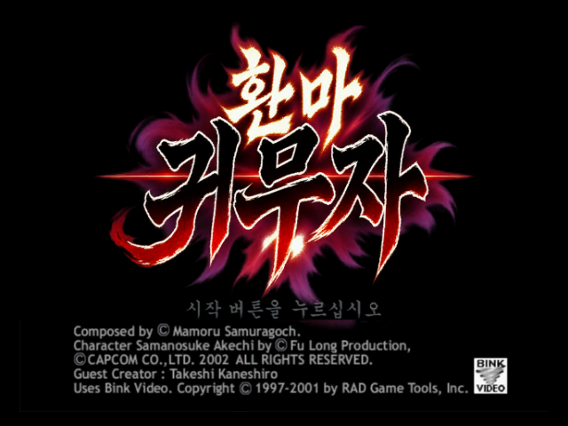
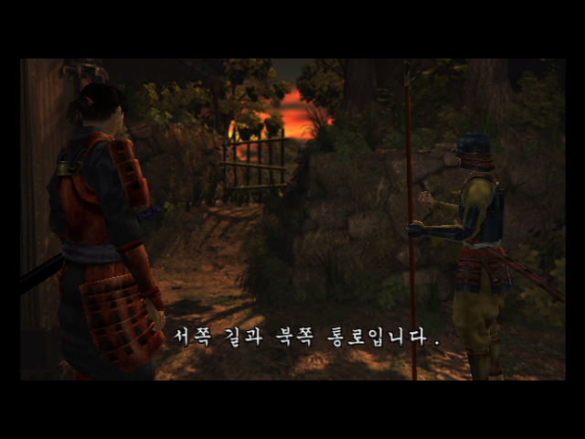

# XBOX-Genma-Onimusha-Kr v0.801

**기존 v0.8 한글 데이터에 적용하는 XBE 교체 테스트 업데이트입니다.**

한글화: **기타 깎는 노인**

## 적용 방법

1. `XBOX-Genma-Onimusha-Kr-v0.801.zip`을 받아 압축을 풉니다.
2. **폴더로 풀어 놓은 v0.8 한글 게임**의 기존 `default.xbe`를 백업합니다.
3. ZIP의 `default.xbe`를 게임 폴더 최상단에 복사해 교체합니다.
4. 나머지 한글화 데이터는 그대로 사용합니다. 이미 일본판 원본 XBE로 바꿔 한글이 깨진 상태에도 같은 방법으로 적용합니다.

처음 설치한다면 먼저 [v0.8 기본 한글 패치](https://github.com/OldManCraveGuitars-bit/XBOX-Genma-Onimusha-Kr/releases/tag/v0.8)를 적용해야 합니다. v0.801은 전체 ISO 패처가 아니며, 순정 일본판 게임에 이 파일 하나만 넣어 전체 한글화를 하는 용도가 아닙니다.

## 변경 내용

이 파일도 **수정 XBE**입니다. 원본의 23개 섹션 구조와 기존 헤더·이름·참조 포인터 배치를 유지하면서, 한글 처리 코드·문자열·자막 데이터를 포함합니다. 기본 v0.8의 24개 섹션 구성에서 배치를 바꿨습니다. HDD 매체 허용과 파일 끝 정렬을 보정했습니다.

기존 한글 코드·문자열·그림과 원본 타이틀 아이콘은 유지합니다. 일본판 원본 XBE를 무수정으로 사용하는 방식은 아닙니다.

## 검수 범위

본문 **3,768페이지를 포함한 5,219개 네이티브 출력 조건**이 정상 한글판과 일치했습니다. 글리프 초기화·해제, 메뉴·아이템·저장·선택지·문서·영상 자막·크레딧 12종 검사를 통과했습니다. 이번 패키지의 XBE 해시는 검사한 파일과 동일합니다.

**실기 Xbox 부팅과 전체 플레이는 미검증입니다.** CPU 함수·데이터 검사 결과를 바탕으로 올리는 테스트 릴리스이며, 제보된 실기 실행 불가가 해결됐다고 확정하는 배포물은 아닙니다.

## SHA-256

```text
ad65beb933ef3ce78c5e13e0c4f215ecdf155acbfe1ec3fc0f1c0c57e92a997e  XBOX-Genma-Onimusha-Kr-v0.801.zip
81a65ca47a0e5d72944895a7b0aa0eee609689c1aa0896041ce3c1a95f45664c  default.xbe
```

[MD5·SHA-1·SHA-256 전체 목록](https://github.com/OldManCraveGuitars-bit/XBOX-Genma-Onimusha-Kr/blob/v0.801/HASHES-v0.801.md) · [파일 검증 기록](https://github.com/OldManCraveGuitars-bit/XBOX-Genma-Onimusha-Kr/blob/v0.801/release-manifest-v0.801.json)

## 스크린샷

기존 개발 중 확보한 에뮬레이터 캡처입니다. v0.801 실기 실행 캡처는 아닙니다.




