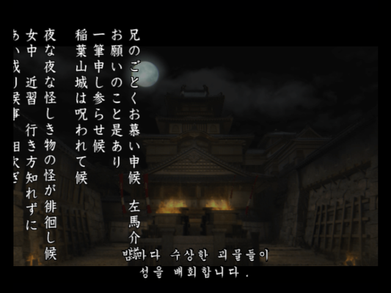

# 환마 귀무자 한국어 패치 v0.8

Xbox용 **환마 귀무자 (Genma Onimusha)** 일본판 한국어 패치입니다.

**한글화: 기타 깎는 노인**

## 원본 XBE 교체 후 한글 깨짐 수정

**[HDD Text Fix ZIP 다운로드](https://github.com/OldManCraveGuitars-bit/XBOX-Genma-Onimusha-Kr/releases/download/v0.8/XBOX-Genma-Onimusha-Kr-v0.8-HDD-Text-Fix.zip)**

일본판 원본 XBE로 교체한 뒤 글자가 깨지는 경우, 이 ZIP의 `default.xbe`를 **v0.8 한글 게임 폴더 최상단에 교체**하세요. 기존 파일을 먼저 백업하고, 나머지 한글화 데이터는 그대로 사용합니다.

원본 23개 섹션 구조에 한글 처리 코드와 데이터를 유지한 수정본입니다. 본문 3,768페이지를 포함한 5,219개 네이티브 출력 조건이 정상 한글판과 일치했습니다. 실기 부팅과 전체 플레이는 미검증입니다.

[상세 적용 방법과 SHA-256](https://github.com/OldManCraveGuitars-bit/XBOX-Genma-Onimusha-Kr/blob/main/docs/HDD-TEXT-FIX.md)

## 적용 범위

대사·조사문·아이템 이름과 설명, 타이틀·설정·조작·저장·지도·강화 메뉴, 문서·지침서·암호책 설명, 이미지 메뉴·랭크, 영상 자막과 오프닝 편지 낭독 자막을 한글화했습니다.

궁서·붓글씨 분위기를 유지하며 글꼴, 숫자, 테두리, 문서 여백과 선택지 간격을 보수했습니다. 원래 암호 퍼즐의 문자와 수집 조건은 유지합니다. 오프닝 일본어 편지 원화에는 음성에 맞춘 가로 한국어 자막을 표시합니다.

v0.8은 내부 검수본 r16까지의 수정 사항을 포함합니다. 최신 텍스트 검수에서 조사문 의미·관찰 표현·인물 말투 5행을 보완했고, 확대 글꼴 처리 중 원본 범위를 벗어나는 읽기를 막는 수정도 반영했습니다.

## 다운로드 · 사용법

1. **`XBOX-Genma-Onimusha-Kr-v0.8-Windows-Patcher.zip`**을 받아 압축을 풉니다. 단독 `-Patcher.exe`도 같은 기능입니다.
2. Windows 패처에서 `Genma Onimusha (Japan) (En,Ja)` 원본 ISO를 선택합니다.
3. 새 ISO 저장 위치를 지정하고 **한글 패치 시작**을 누릅니다.
4. 결과 SHA-256 검사와 완료 메시지를 확인합니다.

Windows 10/11 64비트용이며 Python 설치가 필요 없습니다. 출력 드라이브에 **5.5GB 이상**의 빈 공간을 확보하세요. 결과 ISO는 4GB를 넘으므로 NTFS 또는 exFAT에 저장해야 합니다. 원본과 기존 출력은 덮어쓰지 않습니다. `.xdelta`는 별도 적용 도구를 쓰는 사용자를 위한 파일입니다.

원본 게임 ISO는 포함하지 않습니다. 지원하는 일본판 원본과 해시가 같아야 적용됩니다.

## 원본·결과 ISO SHA-256

| 구분 | 크기 (bytes) | SHA-256 |
| --- | ---: | --- |
| Japan (En,Ja) 원본 | 4,905,566,208 | `7f5af784f9b229c5d0061918e018a9052e328a5341efc7d9e1b5d36de5f58206` |
| v0.8 결과 | 5,385,351,168 | `dbd207078fc41095afe805743277676214fc6e71d2cce2db30f0b161dc0f8dc2` |

MD5·SHA-1·SHA-256 전체 목록은 [HASHES.md](https://github.com/OldManCraveGuitars-bit/XBOX-Genma-Onimusha-Kr/blob/v0.8/HASHES.md)에 있습니다.

### 배포 파일 SHA-256

```text
53e79ac531dc0c5a832bccc12f775b5c85af5575e773dcc3d3df2ad3d5a1c8c4  XBOX-Genma-Onimusha-Kr-v0.8-Patcher.exe
3859ee90301778c4a92549592e7b572fd3a80698db7d6fa6ef19fb97cf9f7a23  XBOX-Genma-Onimusha-Kr-v0.8-Windows-Patcher.zip
e2e4b651ff21c93b1dc2e2486d73a7c500c939cffe18b17a8761f11993b404f2  XBOX-Genma-Onimusha-Kr-v0.8.xdelta
214e71f8f0662dcd7db808aded6668fa30f9ed3ae797865c568f467ab385b20d  HASHES.txt
```

## 스크린샷

개발 중 확보한 에뮬레이터 실행 캡처입니다. 모든 화면을 v0.8에서 다시 촬영한 자료는 아닙니다.




## 검수 범위

현재 한글 본문 3,272행과 메뉴·문서·자막·이미지 문구를 다시 읽었습니다. 원본 코드의 글자 배치로 본문 3,768페이지와 메뉴·선택지 겹침·잘림을 검사했습니다. 배포 EXE로 원본 ISO 전체를 패치한 결과도 위 SHA-256과 일치하며, 잘못된 입력과 기존 파일 덮어쓰기 차단을 확인했습니다.

청취 미확정 음성 2구간과 미재현 특수 방별 선택 분기 7행이 남아 있습니다. 실기 Xbox 및 처음부터 엔딩까지 전체 플레이는 미검증입니다.

[텍스트 검수 내역](https://github.com/OldManCraveGuitars-bit/XBOX-Genma-Onimusha-Kr/blob/v0.8/docs/TEXT_REVIEW.md) · [데이터 호환성 검사](https://github.com/OldManCraveGuitars-bit/XBOX-Genma-Onimusha-Kr/blob/v0.8/docs/HARDWARE_DATA_AUDIT.md) · [배포 패처 검증](https://github.com/OldManCraveGuitars-bit/XBOX-Genma-Onimusha-Kr/blob/v0.8/docs/verification/patcher-v0.8.json)
